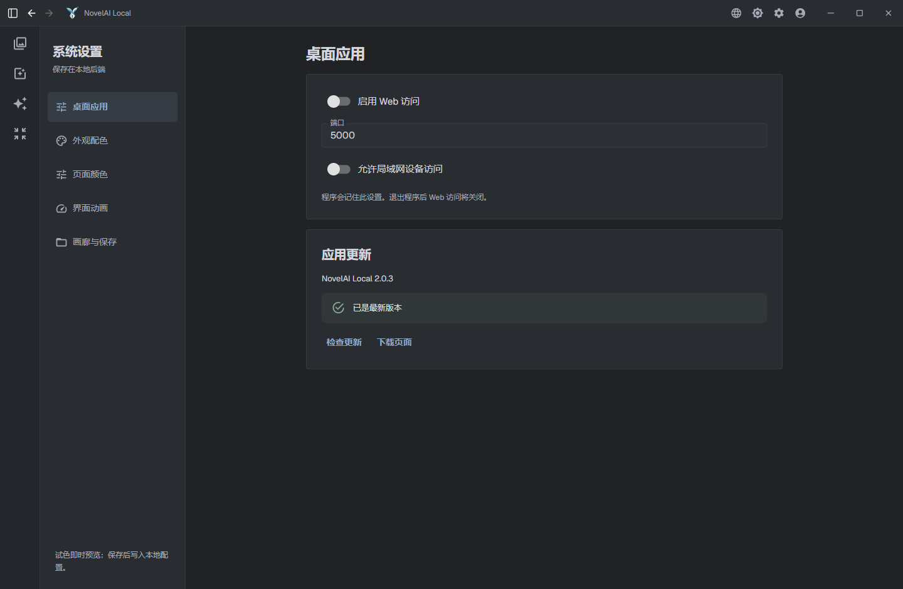
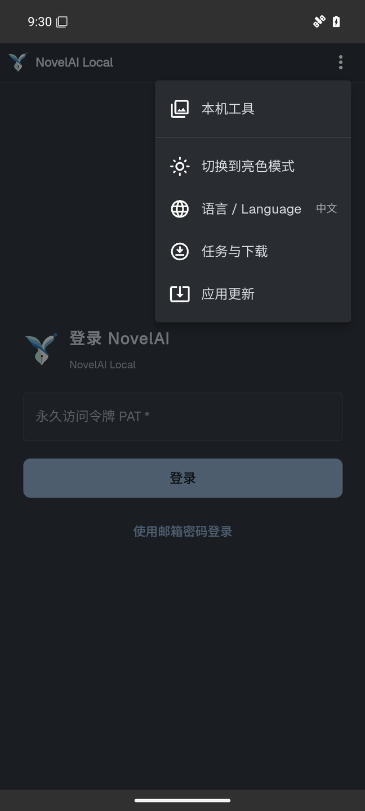
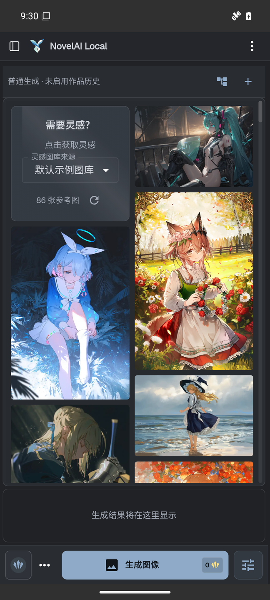
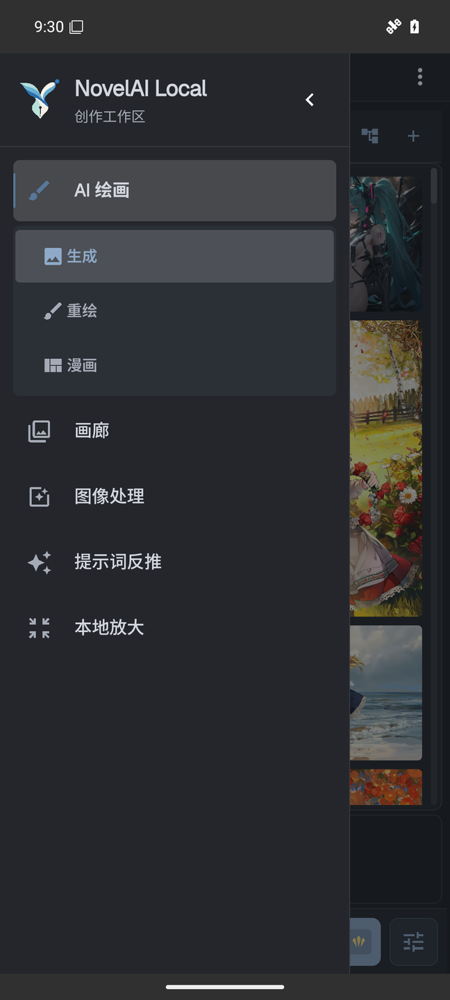
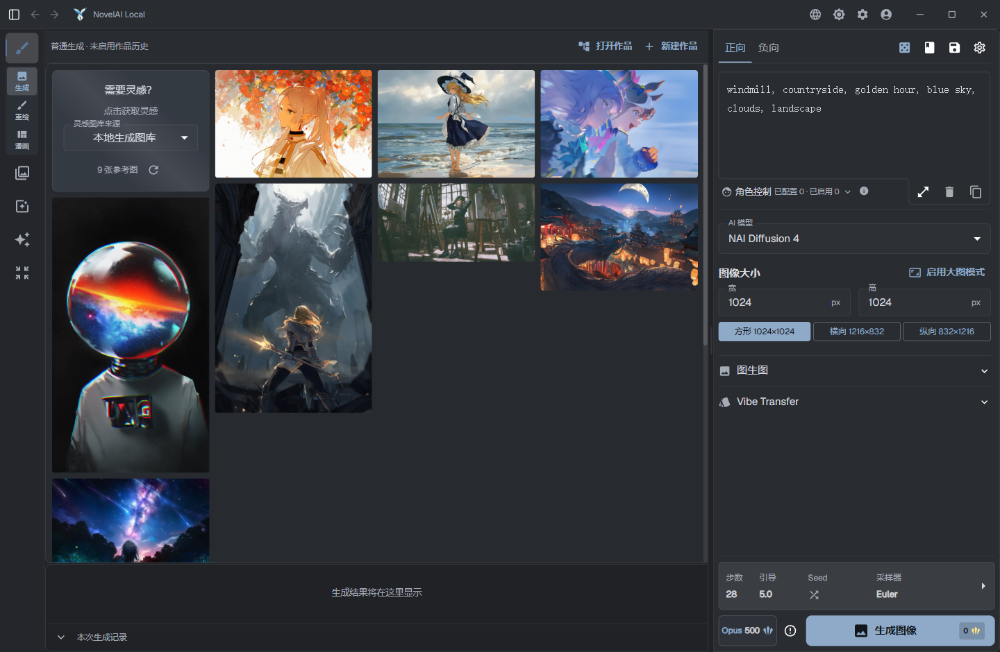
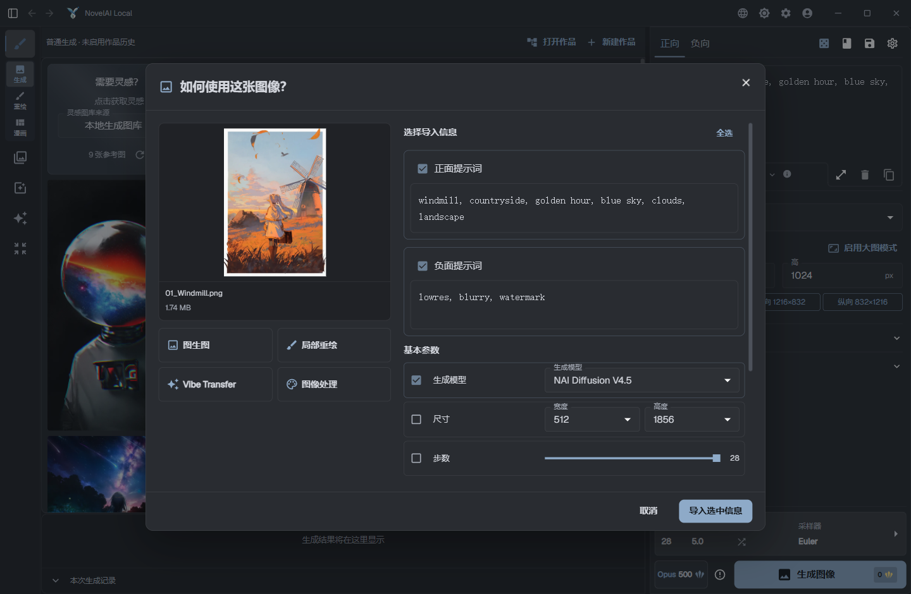
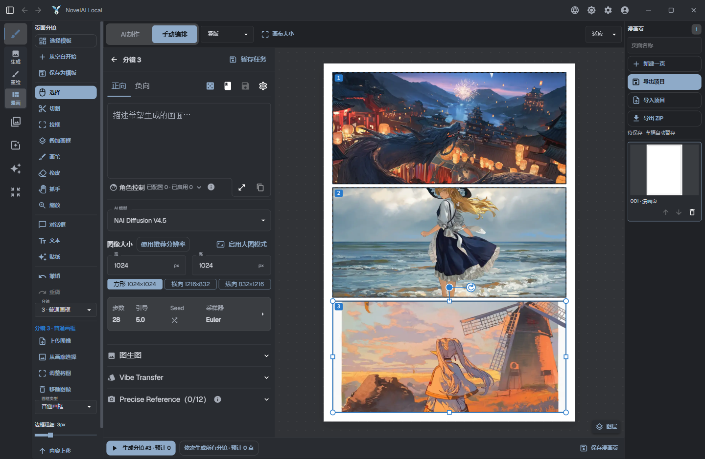
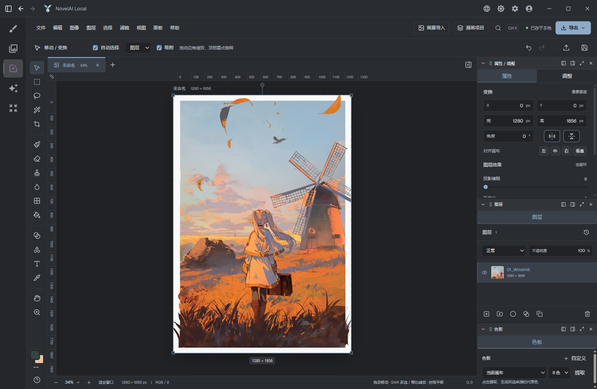
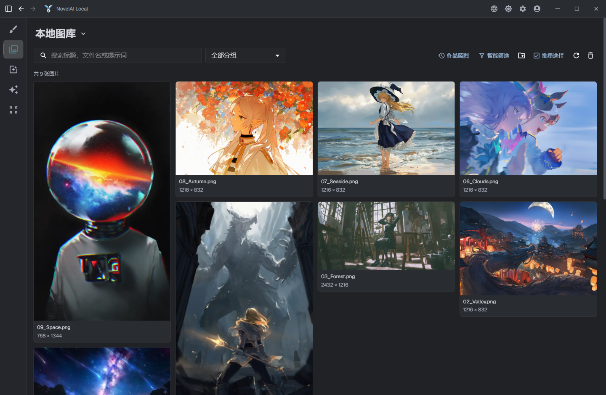
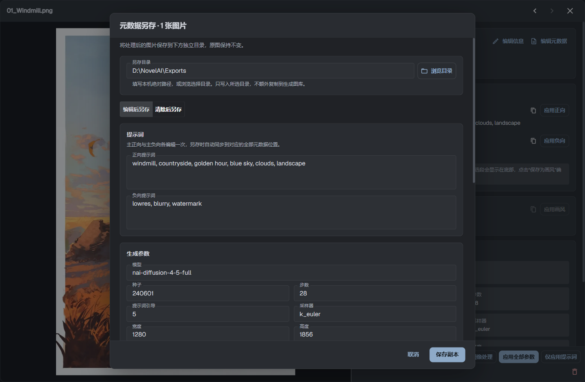

<p align="center">
  
</p>

<h1 align="center">NovelAI Local</h1>

<p align="center">在电脑或手机上使用自己的 NovelAI 账户创作，并在本机整理图片、作品和提示词。</p>

<p align="center">
  <a href="https://yihan.art">在线网站</a> ·
  <a href="https://github.com/YILING0013/novelai_local_web/releases/latest">下载 Windows 安装包</a> ·
  <a href="https://github.com/YILING0013/novelai_local_web/releases/latest/download/NovelAI-Local-Web.zip">下载本地 Web 包</a> ·
  <a href="https://github.com/YILING0013/novelai_local_web/releases/tag/android-v0.1.7">下载 Android APK</a> ·
  <a href="#工作区与功能">界面与功能</a> ·
  <a href="#从源码运行与开发">源码运行</a>
</p>

NovelAI Local 是采用 AGPL-3.0 的非官方社区项目，与 NovelAI / Anlatan 无隶属关系。Windows 和 Android 共用创作工作区。在线生图、订阅、Anlas 和 V5 额度使用自己的 NovelAI 官方账户。图库、作品和本地推理模型存放在运行应用的设备上。

## 安装与使用

| 入口 | 适合的用法 | 运行位置 |
| --- | --- | --- |
| **Windows 桌面版** | 在电脑创作，也可以让同一 Wi-Fi 下的手机通过浏览器访问电脑工作区 | Windows x64，安装包自带应用与后端 |
| **Android 本地版** | 手机上独立创作、整理图库和运行本地工具 | Android 7.0 起，ARM64 或 x86_64，需 Chromium 120 或更新版本的系统 WebView |
| **本地 Web 版** | 运行 Next.js 静态页面和 Flask 后端，开发或使用现有 Web 工作区 | 电脑上的本地服务，浏览器访问 |

### Windows 桌面版

1. 从 [Windows 发布页](https://github.com/YILING0013/novelai_local_web/releases/latest) 下载 x64 安装包，安装后从开始菜单打开 **NovelAI Local**。系统缺少 WebView2 时，安装程序会引导安装。日常使用无需 Python、Node.js 或 Redis。
2. 用官方 **Persistent Token** 或**邮箱密码**登录。若官方要求额外验证码，可改用 Persistent Token。也可在登录窗标题栏打开**本机工具**，直接使用画廊、图像处理、提示词反推和本地放大。
3. 左侧导航切换工作区，标题栏打开语言、主题、账户和设置。账户页可查看订阅、固定与购买 Anlas，以及账号可用的 V5 额度。**设置 → 桌面应用**可手动检查并安装签名更新，更新前保存正在编辑的项目。

桌面版默认不开 HTTP 端口。需要浏览器访问时，在 **设置 → 桌面应用**打开 Web 访问，电脑可使用 `http://127.0.0.1:5000`。需要手机浏览器访问时，再开启局域网并打开设置显示的地址。浏览器单独登录，与桌面端共享电脑上的图库、作品和模型。电脑退出应用或关闭 Web 访问后，浏览器会断开。局域网访问使用 HTTP，适用于可信的私人网络。 [桌面版详细说明](docs/desktop.md)



### Android 本地版

1. 从 [Android 发布页](https://github.com/YILING0013/novelai_local_web/releases/tag/android-v0.1.7) 下载签名 APK，打开文件并按 Android 提示安装。应用名为 **NovelAI Local**，可与 NovelAI Mobile 并装。由旧调试签名版迁移时，先导出重要图片、笔记和项目，再安装正式版。
2. 在手机上直接用 NovelAI 官方账户登录。离线时可从登录页打开**本机工具**，浏览本机图库、编辑图片或使用已下载的模型。在线生成、官方标签补充、机器翻译和模型下载需要网络。
3. 左上角侧栏切换绘画、局部重绘、漫画、图像处理和画廊；画布底部打开生成参数及常用工具，顶部更多菜单打开账户和设置。点按生成栏的订阅或点数入口可查看 Anlas 明细。
4. 在右上角的**应用更新**手动检查新版。正式版支持应用内下载并交由 Android 确认安装。应用会校验安装包摘要、包名和签名。连续生成期间保持应用运行，系统结束应用后可在画廊查看已保存的图片。

Android 独立安装版直接使用手机的存储和 CPU。画廊、模型和编辑数据保存在应用私有空间。通过系统文件选择器导出图片、笔记、漫画与元数据副本，批量元数据副本以 ZIP 导出。卸载会移除应用私有数据，换机或卸载前请先导出要保留的内容。 [Android 详细说明](docs/android.md)

<p align="center">
  
  
  
</p>

## 工作区与功能

Windows 截图来自当前源码构建，Android 截图来自 0.1.3。在线界面使用演示会话，截图中的图片取自项目内置素材，参数和额度为示例。

### 绘画、模型和提示词

- **普通生成和图生图**。选择模型、画幅和尺寸，填写正负提示词，在参数栏调整步数、引导强度、采样器和 Seed。连续生成支持 1–8 张，可逐张查看结果和停止后续请求。需要复现图片时，可使用单张模式并手动填写 Seed。
- **角色与参考**。可为各个角色设置独立提示词与位置。V3 / Furry V3 和 V4 系列按模型提供 Vibe Transfer。V4.5 和 V5 提供精确参考。V5 Curated 和 Full (High) 可在文生图、图生图中参考角色、画风或服装，强度可调至 5。Full (Medium) 添加参考图后自动切换至 High，移除全部参考图后恢复 Medium。每张启用的参考图每次生成另计 5 Anlas。
- **提示词工具**。使用标签联想、权重快捷键、V4 / V5 Tokenizer、随机提示词和分组笔记。中文词库帮助查找标签，翻译预览保留提示词和权重原文。开启机器翻译时，词库未命中的文本会交给在线翻译服务。
- **生成结果**。可开启自动保存到生成画廊，也能手动下载，或把单张结果送到局部重绘和图像处理。工具栏显示官方 Anlas 预估，实际扣费由 NovelAI 决定。



### 导入图片和局部重绘

- **拖图导入**。将图片拖入工作区，选择用于图生图、Vibe Transfer、角色参考、局部重绘或图像处理。图片含生成信息时，可以预览并编辑正负提示词、角色和生成参数，勾选要导入的内容。Seed 默认不勾选，需要复现时可手动选中。
- **局部重绘与扩图**。从文件或画廊载入原图，用蒙版涂出需要修改的区域。调整画布和图像位置可扩展边缘，再预览生成结果，并选择要合并回画布的版本。
- **官方图片工具**。使用 Upscale 放大、Enhance 增强或 Augment 调整图像。工具可用性和消耗随模型、图片及参数变化。



### 漫画制作

在绘画工作区切换到**漫画制作**。用 28 种模板或画框切割排版，添加图层、文字和素材。每格可保存独立的模型、提示词、人物和参考设置，按画框比例应用推荐分辨率，逐格生成或依次生成整页。生成期间可以切换画框，结果会回填对应画框。

**AI 制作**可从剧情或已有提示词编排分镜，先预览并修改角色位置和对白，再确认生成。文字识别、去字和对白重建在本机以 CPU 运行，首次使用需要下载模型。可使用 NovelAI 或在**模型设置**中配置自己的编排服务。**导出项目**保留图层和可编辑内容，**导出 ZIP**按页输出 PNG。 [漫画制作与快捷键](docs/comic-workspace.md) · [AI 漫画与服务配置](docs/ai-comic-local.md)



### 图像处理

从文件、生成结果、画廊或漫画导入素材，使用独立图层、画笔、选区、文字、滤镜和蒙版进行编辑。支持导入 PSD；导入漫画后，每页可作为独立文档继续处理。可导出图片或 PDF，也可以保存可编辑项目，之后重新打开。Android 上从图像处理工具栏打开画笔、选区和颜色。 [图像处理与项目格式](docs/image-processing.md)



### 画廊、参考素材和元数据

- **生成画廊与参考素材**。在同一入口切换保存结果和收藏的图片。支持多图导入、搜索、分组和批量整理。分组只整理索引。移入回收站的图片可恢复。
- **回用图片信息**。点开详情后，可以只应用正向或负向提示词，也可以应用两组提示词或全部可识别参数。选中提示词中的片段可保存成画风，之后追加到任意正向提示词。
- **编辑或清除元数据**。查看和编辑 PNG 文本、EXIF 与支持的隐写字段，包括提示词、角色坐标和生成设置。批量编辑可只改所选字段，也可从已选图片中选一张作为整批模板。编辑或清除后另存副本，保留原图。
- **智能筛选和动态收藏**。按模型、画幅、标签与分组组合筛选，或从一张图片查找提示词相似的其他图片。把条件保存为动态收藏后，符合条件的新图会自动归入。





### 作品蓝图与版本

用**新建作品**开启版本记录，首张图片成为 V1，也可以从画廊把已有图片加入作品。后续生成或主动保存提示词版本会创建新节点。可以从任意节点分支，比较提示词增删、权重和参数变化，并复用该节点已保存的编辑状态。蓝图可缩放拖动、框选成组、折叠或隐藏分支，也可以为连线添加备注。退出作品后仍可继续普通生成，既有版本可从作品列表打开。 [作品版本与智能图库](docs/work-versions-and-smart-gallery.md)

### 本地推理和工作区设置

- **提示词反推**使用 SwinV2 或 PixAI 模型从本机图片提取标签；**本地放大**提供 QuickSRNet 等超分模型。Windows 原生版使用 ONNX Runtime，可按模型使用 CPU 或 DirectML；Android 使用 CPU；源码 Web 版使用电脑上的 Python 推理运行时。模型下载完成后可离线处理，不消耗 NovelAI Anlas。 [源码 Web 版推理配置](docs/local-inference.md)
- **工作区设置**提供中英文、明暗主题、主题色、背景和动画调整。画廊与保存设置控制自动保存和灵感来源；Windows 可配置生成图片的保存位置，Android 使用应用私有存储并通过系统导出。

## 数据与备份

| 入口 | 数据位置与备份方式 |
| --- | --- |
| Windows 桌面版 | 默认在 `%LOCALAPPDATA%\cc.idlecloud.novelai.local`。退出应用后备份完整目录，另外复制自定义的图片目录，并导出需要迁移的漫画、图像处理项目和笔记。 |
| Android 本地版 | 数据保存在应用私有目录。使用画廊和编辑器的导出入口，把原图、图片副本或可编辑项目保存到系统文件选择器选定的位置。 |
| 源码 Web 版 | 默认在 `nai_flask/data`。停止服务后备份整个数据目录以及自定义的输出目录。以同一时点备份 `image-library.db` 和 `version-assets/`，保留图库索引和版本快照。 |

工作区按设备与入口保存。通过 Windows 桌面版的 Web 入口访问时，共享的是同一台电脑的资料。Android 独立版使用另一份本地资料，跨设备搬迁请通过项目和文件导出。漫画与图像处理的部分草稿保存在各自的 WebView 或浏览器存储中，换设备、浏览器或访问地址前先导出可编辑项目。

桌面会话使用 Windows DPAPI 保护。Android 使用 Android Keystore 保护官方访问凭据。Flask Web 版的官方凭据保存在后端进程内存中，重启后需重新登录；浏览器使用本机会话 Cookie。

## 从源码运行与开发

- **Windows 原生版**使用 Tauri 2、Vite / React 和 Rust。安装依赖、原生推理库和 NSIS 打包步骤见 [Windows 构建说明](docs/desktop.md#从源码构建)。
- **Android 本地版**使用 Capacitor、共享 React 界面和 Rust 核心。Android SDK、NDK、调试 APK 和设备测试步骤见 [Android 构建说明](docs/android.md#从源码构建)。
- **本地 Web 版**使用 Next.js 静态页面与 Flask / Waitress，保留独立的本地启动方式。Windows 需要 Python 3.11+（含 `py` Launcher）和 Node.js 20.19+（含 npm）。

```powershell
git clone https://github.com/YILING0013/novelai_local_web.git
cd novelai_local_web
.\setup.bat
.\start.bat
```

`setup.bat` 安装依赖并生成 `next_nai_web/out`，`start.bat` 启动服务后打开 <http://127.0.0.1:5000/login>。更新源码时，先关闭旧服务，再运行 `setup.bat` 和 `start.bat`。自动化测试与发布扫描见 [贡献指南](CONTRIBUTING.md)。

<details>
<summary><strong>源码 Web 版的局域网和配置</strong></summary>

同一 Wi-Fi 下的手机可访问电脑运行的 Web 工作区。关闭旧服务，运行 `start-lan.bat`，再用手机浏览器打开窗口显示的电脑局域网地址。手机须单独登录。浏览目录、自动保存和元数据另存均使用电脑磁盘，浏览器手动下载则保存到当前设备。页面打不开时，检查电脑是否仍在运行服务、Windows 专用网络防火墙和路由器客户端隔离设置。HTTP 局域网入口适用于可信的私人网络。

要修改端口、允许局域网、指定数据目录或调整上游超时，可复制 `nai_flask/config.example.json` 为 `nai_flask/config.local.json`。默认端口 `5000`、`allow_lan` 为 `false`、`data_dir` 为 `data`、`upstream_timeout_seconds` 为 `120`。修改后重启服务。相对数据路径以 `nai_flask` 为基准。

源码 Web 版备份时还应保留 `novelai-tls-bindings.json`，用于恢复凭据摘要对应的 TLS 配置。旧画师串和图片参考记录会迁入参考素材或提示词笔记，源数据库和图片保留。启用漫画编排的“记住密钥”后，Flask 版会以明文保存自定义服务密钥到数据目录的 `comic-llm-keys.json`。反馈问题时可提供错误码和 correlation ID，凭据与本地数据备份请保存在自己的设备上。

</details>

## 许可证

本项目按 [GNU Affero General Public License v3.0](LICENSE) 发布。使用 NovelAI 在线功能时遵守 [NovelAI 服务条款](https://novelai.net/terms)。
