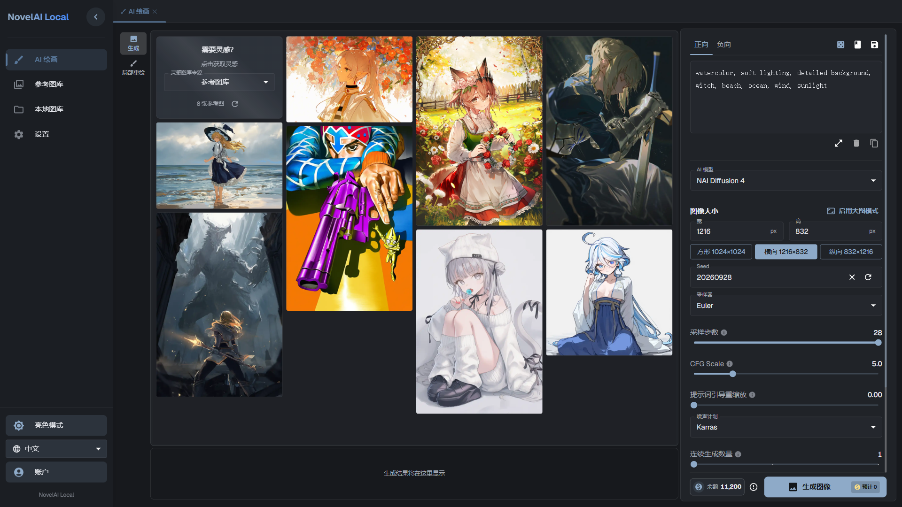
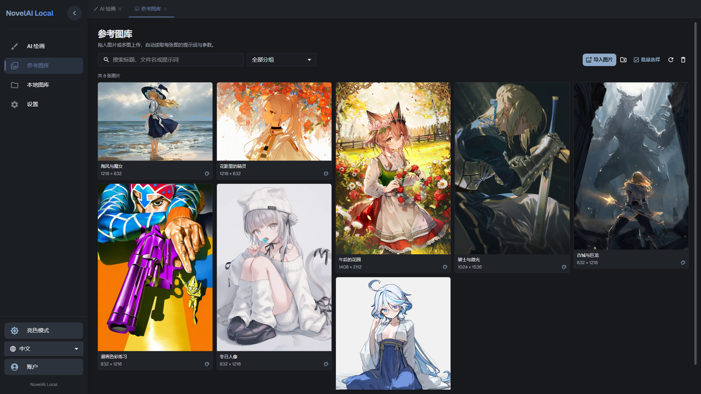
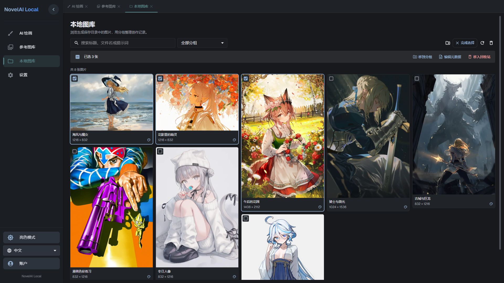
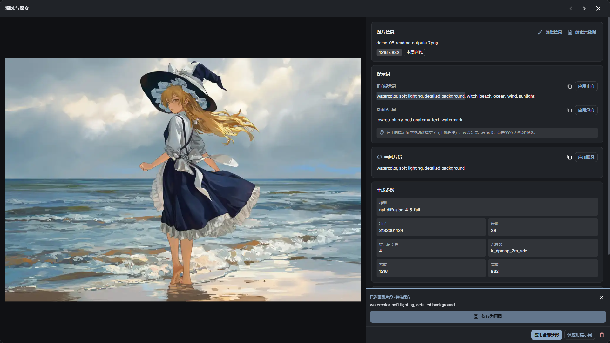
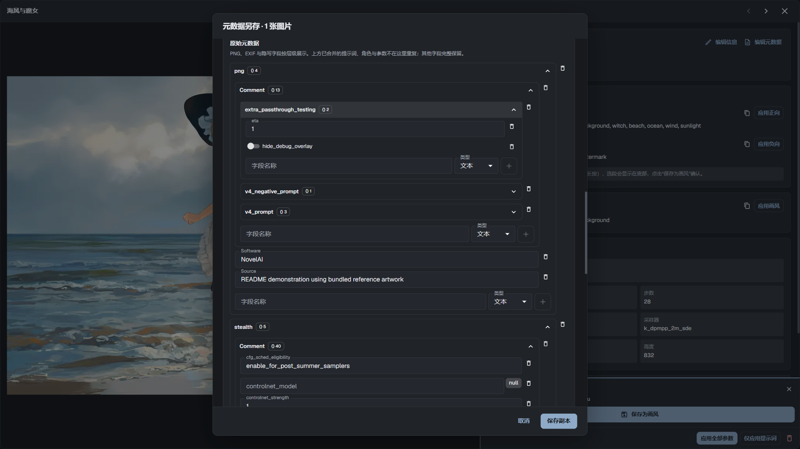
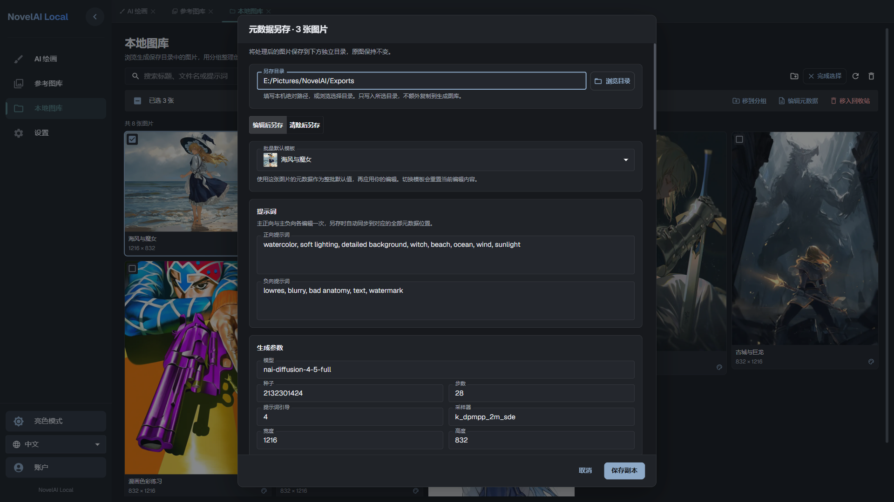
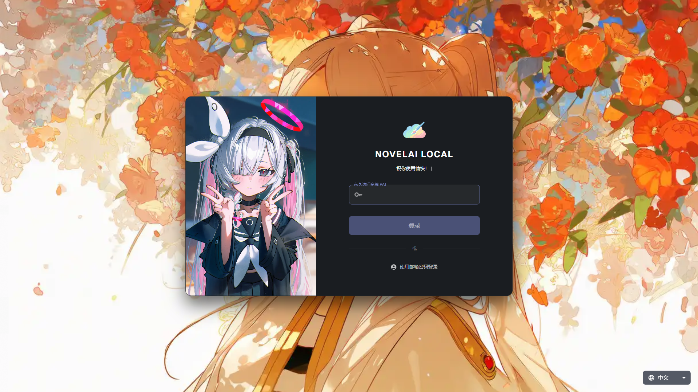
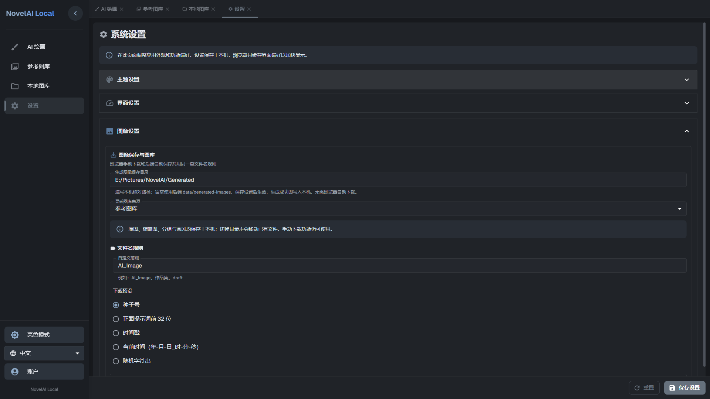
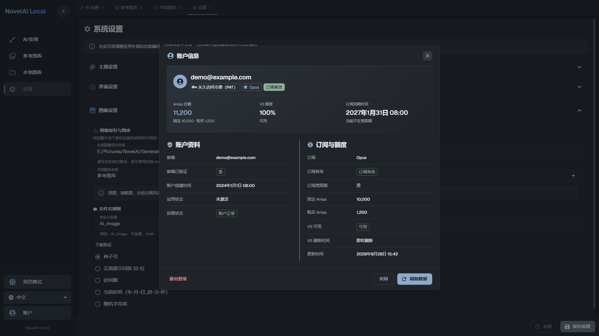

<p align="center">
  
</p>

<h1 align="center">NovelAI Local Web</h1>

<p align="center">在本机完成图像创作、参考整理与元数据编辑的 NovelAI 工作台</p>

<p align="center">
  <a href="https://nai.idlecloud.cc">在线网站</a> ·
  <a href="#界面与使用流程">界面预览</a> ·
  <a href="#快速开始">快速开始</a> ·
  <a href="#配置与数据">配置与数据</a> ·
  <a href="./LICENSE">AGPL-3.0 许可证</a>
</p>

NovelAI Local Web 是面向 Windows 个人用户的本地 Web 客户端。提示词、模型参数、角色控制、参考图片和生成结果集中在一个响应式工作台中；图片与创作资料保存在自己的电脑上。

前端使用 Next.js / React / MUI，后端使用 Flask / Waitress。构建后的页面与 `/api` 由同一个本地服务提供，默认地址为 `http://127.0.0.1:5000`；登录、账户查询和图像生成通过后端访问 NovelAI 官方服务。

本项目为非官方社区项目，与 NovelAI / Anlatan 无隶属关系。需要自行准备可用的 NovelAI 账户；账户权限和实际费用以官方返回为准。默认仅允许本机访问，也可主动开启局域网模式供同一 Wi-Fi 的手机使用。

## 功能概览

| 功能 | 可以做什么 |
| --- | --- |
| 图像创作 | 文生图、图生图、局部重绘、连续生成、Upscale 放大、Enhance 增强与 Augment；显示官方 Anlas 预估 |
| 漫画制作 | 28 种分镜模板、边缘吸附切割、画框旋转与元素变换、独立生成任务、图层管理，以及可编辑项目导入导出 |
| 图像处理 | 多图层编辑、画笔、选区、文字、滤镜、PSD 导入；从本地图库或漫画导入，保存可编辑项目并导出图片 / PDF |
| 模型与角色 | V3 / Furry V3、V4、V4.5、V5 / V5 Medium，角色提示词与位置控制，以及模型支持的 Vibe / Director 工具 |
| 提示词 | 标签联想、词库与机器翻译预览、权重快捷键、V4 / V5 Tokenizer、随机提示词和三级分组笔记 |
| Python 本地推理 | SwinV2、PixAI v1.0 FP32 / FP16 / INT8 反推；五种本地放大模型；后端自动下载和校验，结果保存到本地图库 |
| 参考图库 | 拖入或多图上传，读取每张图的元数据，保存画风片段，建立个人参考集合 |
| 本地图库 | 浏览生成保存目录，分页瀑布流、搜索、虚拟分组、批量选择、恢复及确认后彻底删除 |
| 作品蓝图与版本 | 可拖动缩放的分支画布，框选成组、折叠与隐藏、连线思路备注；红绿提示词原文差异和蓝色权重/参数变化，任意节点复用全部已保存参数 |
| 智能图库 | 组合模型、画幅、标签与分组筛选，按提示词相似度查找图片，保存自动更新的动态收藏 |
| 元数据处理 | 分层查看和编辑 PNG、EXIF、隐写内容；批量选图作为模板，编辑或清除后另存 PNG |
| 账户与界面 | 官方账户、订阅、Anlas 与 V5 额度；中英文、亮暗主题、主题色与背景设置 |

不同模型支持的参数有所区别，界面会按模型调整可用工具。参考图库与本地图库是两个独立入口，共用详情、分组与元数据编辑操作。

标签联想查询 NovelAI 官方接口，并结合随项目附带的词库补充中文搜索和翻译。新增的机器翻译优先查词库，未命中的文本由浏览器发送到 Index-Translate 在线服务；可在提示词设置中关闭或指定目标语言，原文及权重不被替换。手机端可滚动建议列表并直接选词。官方图片工具中的点数为 Anlas 预估，实际扣费以官方为准。

本地反推与放大由电脑上的 Python 执行，不调用 NovelAI 图像接口或消耗 Anlas。页面仍沿用本地会话登录。详见 [本地推理配置](docs/local-inference.md) 和 [近期同步清单](docs/sync-2026-10-16.md) 和 [图像处理说明](docs/image-processing.md)。

## 界面与使用流程

以下为 **1920 × 1080 的演示工作区截图**，使用项目自带示例图片搭建，不涉及真实账户，也不表示截图中的图片是本次实际生成的结果。

### 1. 创作工作台

桌面侧栏支持隐藏、图标与完整菜单三档，绘画参数栏可拖拽调整宽度。左侧浏览图库与灵感图片，右侧编写正负提示词并配置模型、画布和角色，底部参数条可直接调整步数、引导、种子和采样器。灵感来源可在卡片或设置中切换为内置示例、参考图库或本地图库。



单张生成保留手动填写的 Seed，留空时使用随机值。连续生成支持 1–8 张，逐张显示结果，相邻请求间隔 15 秒；取消会阻止后续请求，异常时停止且不会自动重试。连续生成每张使用新的 Seed，需要复现时请选择单张。

成功的生成结果由后端自动保存到输出目录。刷新或关闭页面不会删除已保存的文件，手动下载入口仍可使用。

默认普通生成只保存到图库。点击工作台上方的**新建作品**后，才启用作品历史与**作品蓝图**，首张生成图片成为 V1；**退出作品**会保留当前编辑内容和已有历史，后续生成回到普通模式。蓝图画布可以拖动缩放、框选成组、折叠路径或隐藏节点，并在连线上记录创作思路；折叠和隐藏随时可以恢复。两个节点的提示词原文用红绿显示增删，权重和参数变化用蓝色区分。启用作品后，生成或保存版本时才创建新节点，每次按键不会产生版本；布局和备注可编辑，历史参数与图片快照保持不变。

从任意节点继续创作可以复用全部已保存参数。新节点还保存完整参考图与 Vibe 编辑态、角色名称和临时禁用状态；旧节点中未保存的原始素材或名称不会自动补回。已有 V1 后，**保存提示词版本**可单独保存后续草稿，不消耗 Anlas。**应用所有参数**只填入编辑区，**从此节点继续**才切换创作节点。作品列表支持多选删除，保留图库原图。图库中的**智能筛选**与**找相似提示词**帮助整理已有图片，**动态收藏**会随新图片自动更新。使用方法与备份要求见 [作品版本与智能图库](docs/work-versions-and-smart-gallery.md)。

在 **Inpaint 下方的“漫画制作”** 进入漫画工作区。选择画框后可独立设置提示词、模型、角色和参考图；参数区“图像大小”旁的 **使用推荐分辨率** 按钮会匹配画框比例，只有点击时才更改尺寸，重新进入时保留自定义值。生成结果保存到本地画廊后回填原画框，生成期间可以切换画框。

漫画页面、草稿、模板与自定义字体保存在当前浏览器。**导出项目** 打包可继续编辑的完整数据，**导出 ZIP** 按页序输出 PNG。跨浏览器、电脑或地址访问时，请先导出项目，再在目标工作区导入。详见 [漫画制作与快捷键](docs/comic-workspace.md)。

**AI 制作漫画页** 可将剧情或原生提示词编排成完整漫画，再以 CPU 识别、去字并重建可编辑对白。支持计划编辑、双区串行生成、单区重试和仅重建文字；已有分镜只用于编排参考，生成结果完整替换旧画框。首次文字处理需下载约 303 MB 模型。使用方法、模型来源和验收边界见 [本地 AI 漫画制作](docs/ai-comic-local.md)。

### 2. 参考图库与本地图库

**参考图库**用于收藏外部参考。拖入图片或一次上传多张即可导入，标题和提示词无需预先填写；有元数据时自动提取，没有时可在详情中补充。



**本地图库**读取设置中的生成输出目录。使用缩略图瀑布流浏览结果，可搜索、选择多张、移动分组或放入回收站。分组只整理图库记录，不移动原图；删除会把文件移入应用专用回收站，可恢复到原位置，遇到同名文件时会提示冲突而不覆盖。



### 3. 图片详情：分别应用提示词、画风和参数

大图旁按卡片展示图片信息、主提示词、画风、角色与生成参数。长文本可滚动阅读，其他嵌套字段可逐层展开。

- **应用正向 / 应用负向**：只替换对应方向的提示词，保留另一方向和当前参数。
- **仅应用提示词**：同时应用正负提示词。
- **应用画风**：将保存的画风片段追加到当前正向提示词，也可单独复制画风。
- **应用全部参数**：回填图片中可识别的生成设置与角色信息。
- **保存为画风**：在主正向或角色正向提示词中选择文字，在底部确认区查看选段并保存；手机可长按选词。



“编辑信息”修改图库记录；需要将参数写入图片文件时，点击图片信息卡片中的 **编辑元数据**。

### 4. 可视化元数据与批量模板

元数据编辑以表单展示主正负提示词、每个角色的提示词与坐标，以及其他生成参数。PNG 文本、EXIF、alpha / RGB 隐写中的已识别重复字段合并编辑，同一角色按索引分别对应；未知对象、数组、布尔值和空值仍可展开、修改或增删，无需手写 JSON。



批量选图后点击 **编辑元数据**，可选择两种方式：

1. **不使用模板**：只覆盖本次改动的字段，每张图保留其余原值。
2. **选择已选图片作为模板**：通过缩略图和标题挑选一张，加载其完整元数据作为整批默认值，再继续编辑。模板替换元数据，不替换每张图片的图像内容。

也可以选择“清除后另存”，移除文本、EXIF 和支持的隐写元数据。编辑、清除与模板操作都创建新文件，原始图片保留。

### 5. 另存到指定目录

填写本机绝对路径，或通过 **浏览目录** 选择磁盘、进入子目录和返回上一级。默认建议位置是 `nai_flask/data/metadata-exports`；目录尚不存在时，会在保存时创建。



副本只写入所选目录，不额外复制到生成图库，也不覆盖已有文件。若主动选择了生成输出目录，新文件会在图库扫描时显示。

<details>
<summary><strong>登录、账户与个性化设置</strong></summary>

登录支持 **Persistent Token** 和 **邮箱密码**。若官方要求额外验证码，请改用 Persistent Token。



设置页可调整语言、亮暗主题、主题色、背景和动画；**生成图片保存目录**决定自动保存与本地图库读取的位置，**灵感来源**决定工作台使用哪一组图片。这与元数据另存时单独选择的目录相互独立。



账户页集中显示登录方式、订阅状态、固定与购买 Anlas、V5 额度，并可手动刷新。通过邮箱密码登录时，还可按页面提示管理账户凭据；修改前请先在官方页面备份重要内容。



</details>

## 快速开始

需要 Windows 10 / 11、Python **3.11+**（含 `py` Launcher）、Node.js **20.19+**（含 npm），以及可访问 NovelAI 官方服务的网络。

```powershell
git clone https://github.com/YILING0013/novelai_local_web.git
cd novelai_local_web
.\setup.bat
.\start.bat
```

也可下载源码压缩包解压，先双击 `setup.bat`，完成后双击 `start.bat`。

- `setup.bat` 创建 `nai_flask/.venv`、安装后端和前端依赖，并构建静态页面到 `next_nai_web/out`。
- `start.bat` 启动本地服务，就绪后自动打开 <http://127.0.0.1:5000/login>。保持启动窗口开启，按 `Ctrl+C` 或关闭该窗口停止服务。
- 启动器会复用当前项目已运行的健康服务；其他程序占用端口时会报错，不会自动换端口。
- 更新源码时，先停止旧服务，重新运行 `setup.bat`，完成后再运行 `start.bat`。

### 同一 Wi-Fi 的手机访问

1. 电脑和手机连接同一路由器的局域网，手机使用普通 Wi-Fi，不使用访客网络；电脑也可以通过网线连接该路由器。
2. 如果已经启动服务，先关闭旧启动窗口，再双击 **`start-lan.bat`**。在手机浏览器打开启动窗口显示的局域网地址，例如 `http://192.168.1.20:5000/login`，然后单独登录 NovelAI 账户。手机无需安装本项目，也不要输入 `127.0.0.1`。
3. 在电脑的 **设置 → 网络和 Internet → Wi-Fi → 当前网络属性** 中，将可信家庭 Wi-Fi 设为**专用网络**。Windows 首次询问 Python 的网络访问权限时，只允许专用网络；防火墙放行范围应限于该 Python 程序、服务端口和本地子网，不要放行公用网络。启动器不会修改网络类别、防火墙或自动更换端口。

`start-lan.bat` 只为本次启动开启局域网访问；需要持续启用时，可在下面的 `config.local.json` 中设置 `"allow_lan": true`，以后使用 `start.bat` 启动即可。电脑应保持开机、唤醒和服务窗口运行；切换网络或电脑 IP 变化后，重启服务并使用新显示的地址。

手机和电脑共享电脑上的图库、笔记与设置，登录会话和浏览器草稿各自独立。生成保存目录、浏览目录和元数据另存路径都指**电脑的磁盘**；手动下载则由当前手机或电脑的浏览器保存。

局域网 HTTP 页面支持文字复制；浏览器不允许直接复制图片到剪贴板，请使用图片的**下载**按钮保存后再分享。

局域网模式使用 HTTP，传输内容未加密，只用于可信的家庭或私人网络；不要开启公网端口转发，也不要关闭防火墙或向公用网络开放服务。

若手机仍打不开页面，检查 Python 的防火墙规则，以及路由器是否启用了访客网络或 AP / 客户端隔离。

## 配置与数据

### 服务配置

默认配置可直接使用。需要修改端口、局域网访问、数据位置或请求超时时，在项目根目录执行：

```powershell
Copy-Item .\nai_flask\config.example.json .\nai_flask\config.local.json
```

编辑 `nai_flask/config.local.json`：

```json
{
  "port": 5000,
  "allow_lan": false,
  "data_dir": "data",
  "upstream_timeout_seconds": 120
}
```

`allow_lan` 默认 `false`，仅监听本机；设为 `true` 后允许通过电脑的局域网 IPv4 地址访问。`data_dir` 的相对路径以 `nai_flask` 为基准，也可填写绝对路径，例如 `E:/NovelAIData`。配置修改后重启后端；不要在此文件中保存账户凭据。

### 图片目录与工作区

| 位置或设置 | 用途 |
| --- | --- |
| `data/reference-images/` | 参考图库导入的图片 |
| `data/generated-images/` | 默认生成输出目录；设置中的 `outputDirectory` 可改为本机绝对路径 |
| `data/metadata-exports/` | 元数据另存的默认建议目录，每次另存也可另选位置 |
| `data/image-library.db` | 图库索引、作品版本及其 editor_state、work_blueprints 蓝图布局、动态收藏和迁移记录 |
| `data/version-assets/` | 作品版本的不可变图片快照与缩略图；与 image-library.db 一起备份 |
| `data/gallery-thumbnails/` | 图库缩略图缓存 |
| `data/settings.json` | 界面偏好、输出目录与灵感来源 |
| `data/notebook.json`、`data/random-prompts.json` | 词条与分组在同一个文件中原子保存；随机提示词单独保存 |
| `data/notes.json` | 旧笔记来源；首次读取兼容，首次修改写入 notebook.json，旧文件保留 |
| `data/models/` | 默认 Python 模型目录，可通过 inference_models_dir 指定其他位置 |
| `data/novelai-tls-bindings.json` | 账号或 Token 的 SHA-256 摘要与 TLS 配置编号，供重启后恢复绑定 |
| 浏览器存储 | 提示词草稿、部分界面偏好、Vibe 缓存，以及漫画页、草稿、模板、素材和字体 |

表中 `data` 默认指 `nai_flask/data`，随 `data_dir` 调整；自定义生成目录和另存目录可位于它之外。设置中的 `inspirationSource` 分别使用 `default`（内置）、`references`（参考）、`outputs`（本地生成）三种来源。

不同官方账户共享同一个本地工作区。退出、换号或刷新页面不会删除资料。备份时先停止服务，再复制完整数据目录、自定义生成目录和需要保留的另存目录；浏览器草稿不包含在后端数据目录中。备份或搬迁数据目录时一并保留 `novelai-tls-bindings.json`；遗漏此文件会使新进程无法恢复既有 TLS 绑定。

<details>
<summary><strong>旧数据迁移与凭据处理</strong></summary>

旧画师串、图片参考库会迁入参考图库，保留源数据库和图片；多图条目整理为分组，无图记录转入提示词笔记。迁移可在中断后继续，完成后不会重复导入。缺失的数据目录会自动建立，仍在生成目录中的图片可重新扫描，但不会恢复已经从磁盘删除的文件或丢失的分组。

Persistent Token、密码及官方访问凭据保留在后端进程内存中，不写入工作区文件。浏览器使用本机会话 Cookie；本地接口执行会话、来源与 CSRF 校验。服务重启后需要重新登录。不要向 Issue、截图或日志附件中放入真实凭据。

漫画编排的自定义 AI API Key 可在“AI 接口”中选择“在本机记住密钥”，以明文单独保存到数据目录的 `comic-llm-keys.json`；默认只保留在当前会话。取消勾选并保存会移除本地副本，“清除当前接口密钥”同时清除本地与当前会话副本。详见[自定义 AI API 设置](docs/ai-comic-local.md#使用自己的-ai-api)。

所有官方请求使用按身份分配的 TLS 配置：不同账号或独立 Token 使用不同配置，密码登录返回的 Token 与后续账户变更继承对应账号配置。绑定保存在当前数据目录的 `novelai-tls-bindings.json`，只含凭据的 SHA-256 摘要和配置编号，不含 Token、邮箱或密码原文。后端启动时恢复绑定；保留此文件且 TLS 实现环境不变时，同一身份跨重启继续使用相同配置。配置池包含 2048 种安全密码套件组合，保留证书、主机名校验和最低 TLS 1.2；不支持所需套件时明确报错，不退回共用指纹。系统/环境代理和 `REQUESTS_CA_BUNDLE` / `CURL_CA_BUNDLE` 证书路径仍可使用。

绑定文件使用 `schema_version: 1` 和 `bindings` 映射，映射键为 SHA-256 十六进制摘要、值为配置编号。首次分配或新增同一账号的 Token 绑定时，后端先原子保存文件，成功后才更新内存。运行后端的当前用户需要数据目录的读写权限；文件损坏或写入失败会明确报错，不会静默清空或重新分配。遇到文件损坏时，先停止服务，再从备份恢复该文件。此文件已被 Git 忽略，不应手动加入提交。

</details>

## 开发与测试

项目主要目录为 `next_nai_web/`（前端）、`nai_flask/`（后端）和 `scripts/`（启动与发布检查）。先运行一次 `setup.bat` 准备依赖。

从项目根目录进入后端，运行测试后返回：

```powershell
cd nai_flask
.\.venv\Scripts\python.exe -m pytest
cd ..
```

在前端目录运行测试、静态检查和构建：

```powershell
cd next_nai_web
npm test
npm run lint
npm run build
cd ..
```

在项目根目录检查发布边界：

```powershell
.\nai_flask\.venv\Scripts\python.exe .\scripts\verify_release.py
```

自动化测试使用模拟官方接口，不需要真实 NovelAI 凭据。修改前端后需重新构建静态产物；仅重启后端不会更新旧页面。

### 更新到此次同步版本

本次更新加入作品蓝图画布、完整编辑态版本恢复、不可变图片快照和智能图库，继续使用本地账户、现有图库与按身份区分的 TLS 配置。蓝图布局和编辑态复用现有 SQLite 数据库，不增加部署依赖。

先停止旧本地服务并备份完整 `data_dir`，其中 `image-library.db` 与 `version-assets/` 必须保留同一备份时点；自定义生成目录也需备份。再从项目根目录执行 `setup.bat`，成功后运行 `start.bat`（局域网使用 `start-lan.bat`）。后端要求 `requests>=2.32.3,<3`、`urllib3>=2,<3`；安装或构建失败时不要启动混合版本。前端静态产物仍为 `next_nai_web/out`，只读标签词库位于 `nai_flask/prompt_tags`，请随源码完整更新。无需新增环境变量或端口；现有数据库自动增加新表，不需要手工迁移。

更新后重新登录，确认原图库可读，再新建作品确认蓝图为空；也可从图库将现有图片加入作品，验证完整参数应用和版本存储，这些检查不会消耗 Anlas。真实图像操作仍按官方规则计费。回退时停止服务、恢复先前源码并重新运行 `setup.bat`，保留现有 `data` 和自定义图片目录；旧版会忽略新增表及历史快照。

TLS 绑定持久化沿用现有实现；本次作品版本与智能图库同时包含前后端修改，仍需按上述步骤重新构建前端并重启后端。既有纯内存绑定无法从已经关闭的旧进程恢复；升级后每个身份首次使用时分配并保存，后续重启读取同一文件。更新前备份完整数据目录；启动后登录一次，确认数据目录中生成 `novelai-tls-bindings.json`，再重启并确认登录正常、原有绑定保持不变。回退到不含持久化实现的旧版本时保留该文件，旧版本不会提供跨重启固定绑定的保证。

<details>
<summary><strong>常见问题与日志</strong></summary>

| 情况 | 处理方式 |
| --- | --- |
| 找不到 Python / Node.js | 检查 `py -3 --version`、`node --version`、`npm --version` |
| 5000 端口被占用 | 用 `Get-NetTCPConnection -State Listen -LocalPort 5000` 确认进程，再停止对应旧服务或明确调整配置 |
| 手机无法访问 | 用 `start-lan.bat` 启动并使用窗口中的局域网地址；检查同一局域网、非访客 Wi-Fi、路由器隔离和专用网络防火墙设置 |
| 安装或构建失败 | 查看窗口中的首个错误，确认依赖下载与网络后重试 |
| Token 返回 401 / 登录要求验证码 | 在官方页面核对 Token；验证码场景改用 Persistent Token |
| 生成参数报错 | 核对模型与参考图、Vibe、角色等工具是否兼容 |
| 保存目录不可用 | 检查绝对路径和当前 Windows 用户的写入权限 |
| 本地 JSON 损坏 | 保留损坏文件，检查同目录备份文件后再恢复 |

运行日志在启动窗口中。反馈时提供操作步骤、错误码和 correlation ID，避免附带 Token、密码或完整账户响应。临时调试可先在 PowerShell 中设置 `$env:NOVELAI_LOCAL_LOG_LEVEL = 'DEBUG'`，再运行 `start.bat`。

</details>

## 许可证

本项目按 [GNU Affero General Public License v3.0](./LICENSE) 发布。使用 NovelAI 服务时请遵守其[服务条款](https://novelai.net/terms)，并自行负责账户安全、生成内容与费用。
